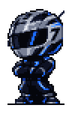

# Felipe Penna
 

### Information Security | SOC & Blue Team | Incident Response | AppSec (SAST/DAST) | Zero Trust | Defender XDR · Sentinel · CrowdStrike
 
🔵 SOC & Blue Team · 🚨 Incident Response · 🛡️ AppSec · 🔐 Zero Trust · 🤖 Security Automation & AI

 
 

 
## About
 
Information Security Intern at a financial institution, on the **Blue Team**: alert triage and investigation with SIEM, EDR and XDR, and **incident response** under tight deadlines.

Alongside that, I work on **AppSec** (SAST/DAST on internal applications, plus AI agents that speed up security reviews with human sign-off) and help with the move to **Zero Trust (ZTNA)**.

Background in software development and IT support. I break down how systems are built to understand how they fail.
 
## What you'll find here
 
- Security labs
- Automation scripts
- Write-ups
  
## Tech Stack
 

  
  
  
  
  
  
  

## Contact
 

